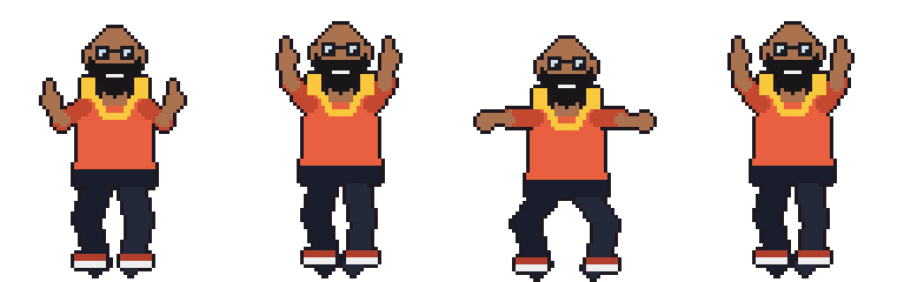

# Lab 04 — The Dance Floor

In class we filled the canvas with a grid of dancers using two nested loops. Each cell has its own color and its own speed, stored in 2D arrays, and `animate()` is a function that draws one dancer. Moving the mouse left and right changes how many columns there are.

In this lab you make the dancers **notice the mouse**, and you fill the floor with **two different dances**. Then you put it on your website.

## Start from the in-class sketch

Use your own code from class. If yours isn't working, the [`starter/`](starter/) folder of this repo has the in-class sketch, ready for your website:

```
starter/
├── sketch.js         the in-class sketch, ready for your website
├── dance_frames/     dance0.png ... dance7.png   (8 poses)
└── jump_frames/      jump0.png ... jump3.png     (4 poses, a second dance)
```



1. In your website repo, copy your `lab-03/` folder and rename the copy `lab-04`.
2. On this repo's GitHub page, click the green **Code** button, then **Download ZIP**. Unzip it.
3. Copy `jump_frames/` into your `lab-04/` folder. If you are using the starter, copy everything inside `starter/` and let it replace `sketch.js`.
4. Open `lab-04/index.html` with Live Server. You should see the grid of dancers before you change anything.

Even better: use your own frames from Lab 03 for one of the two dances.

## What to add

Do **both**.

### 1. Dancers that feel the mouse

Each dancer measures how far it is from the mouse, and uses that distance to set its speed. Dancers near the mouse dance fast. Dancers far away dance slowly (or the other way around, your choice).

You need two p5 functions:

- `dist(x1, y1, x2, y2)` gives the distance between two points.
- `map(value, start1, stop1, start2, stop2)` converts a number from one range to another. `map(d, 0, 500, 2, 20)` turns a distance between 0 and 500 into a speed between 2 and 20.

Do this **inside the nested loop** in `draw()`, so every dancer gets its own distance.

<details>
<summary><b>Hint 1:</b> where is each dancer?</summary>

The dancer in column `i`, row `j` starts at `i * colWidth, j * rowHeight`. That's its top-left corner. The middle of the cell is half a cell further:

```js
let x = i * colWidth + colWidth / 2;
let y = j * rowHeight + rowHeight / 2;
```

Then:

```js
let d = dist(x, y, mouseX, mouseY);
```

</details>

<details>
<summary><b>Hint 2:</b> what numbers go in <code>map()</code>?</summary>

The smallest distance is `0`: the mouse is right on the dancer.

The biggest distance is from one corner of the canvas to the other. You can let p5 measure it:

```js
let maxDist = dist(0, 0, width, height);
```

The output range is the speed. Look at `getFrameIndex()`: `speed` is how many draw-frames each pose stays on screen. So a **small** number is **fast** and a **big** number is **slow**. Close to the mouse should be fast:

```js
let speed = map(d, 0, maxDist, 2, 20);
```

Then pass `speed` to `animate()` instead of `speeds[i][j]`.

</details>

<details>
<summary><b>Hint 3:</b> all the dancers now move in sync. I miss the random speeds.</summary>

Keep the random speed and use the distance to scale it up or down:

```js
let speed = speeds[i][j] * map(d, 0, maxDist, 0.5, 3);
```

Don't let the speed reach `0`. `frameCount / 0` breaks the animation.

</details>

### 2. Two dances on one floor

The grid should alternate between **two different animations**: the 8 dance poses and the 4 jump poses (or your own frames). A checkerboard, stripes, whatever pattern you like, as long as both dances are on the floor.

Your `animate()` function should do this. Don't write a second copy of it. One function, called with different arrays.

<details>
<summary><b>Hint 4:</b> loading the second dance</summary>

There's already an empty `frames2` array at the top of the sketch. Fill it in `setup()` with a loop, exactly like `frames`, but with the jump file names. There are only **4** jump poses, not 8.

</details>

<details>
<summary><b>Hint 5:</b> deciding which dance goes in which cell</summary>

`%` gives the remainder after dividing. `n % 2` is `0` for even numbers and `1` for odd numbers.

- `i % 2` alternates column by column: stripes.
- `(i + j) % 2` alternates in both directions: a checkerboard. Try it on paper: write `i + j` in each cell of a small grid and see which cells are even.

Pick the array first, then call `animate()` once:

```js
let danceFrames;
if ((i + j) % 2 === 0) {
  danceFrames = frames;
} else {
  danceFrames = frames2;
}
animate(danceFrames, speed, ...);
```

</details>

<details>
<summary><b>Hint 6:</b> the dancers freeze after a moment</summary>

Open the console. If you see `Cannot read properties of undefined (reading 'width')`, look closely at `getFrameIndex()`:

```js
let index = slowFrame % frames.length;
```

Which `frames` is that? Inside `animate()`, `frames` is the **parameter**, the array you passed in. But `getFrameIndex()` is a different function and doesn't have that parameter, so it uses the **global** `frames`, the one with 8 poses. It hands back indexes up to 7, and `frames2` only has 4.

Fix: give `getFrameIndex()` a second parameter for the array, and pass it from `animate()`:

```js
let index = getFrameIndex(frames, speed);
```

</details>

### Bonus

- Use the distance for **more than speed**: the size of each dancer (there's a TODO in `animate()` about keeping the scale right), the `fill()` alpha, or a `tint()`.
- Use the distance to **pick the dance**: close to the mouse they jump, far away they dance.
- Add a **third** dance.

Weird is good. Have fun with it.

Put a **comment** above each thing you add that says what it does, in your own words.

## How to hand it in

1. Edit `lab-04/index.html`: change the title and the `<h1>` to Lab 04, and write a sentence or two about how to play with it.
2. Add a link to it on `projects/iat-806/index.html`.
3. Commit and sync, then check that it works at:

```
https://your-username.github.io/projects/iat-806/lab-04/
```

In **Canvas**, submit:

1. The link to your live sketch.
2. The link to your `lab-04` folder in your GitHub repo.

Need a reminder on adding a folder to your site? See [section 4 of the personal-website README](https://github.com/IAT-806/personal-website#4-add-a-submission).

## If something doesn't work

Open the browser console (right-click the page → **Inspect** → **Console**) and read the red text.

- **Blank canvas and `404 (File not found)`**: an image path is wrong. Check the folder name (`jump_frames`), the file name (`jump0.png`), and the extension.
- **Everything freezes, and the console says `Cannot read properties of undefined (reading 'width')`**: an index is past the end of an array. See Hint 6.
- **The dancers flicker wildly, or barely move**: your speed is too small, negative, or huge. `console.log(speed)` inside the loop and check the numbers.
- **Works with Live Server but not on GitHub Pages**: check capital letters. GitHub Pages cares about `Jump0.png` vs `jump0.png`.
